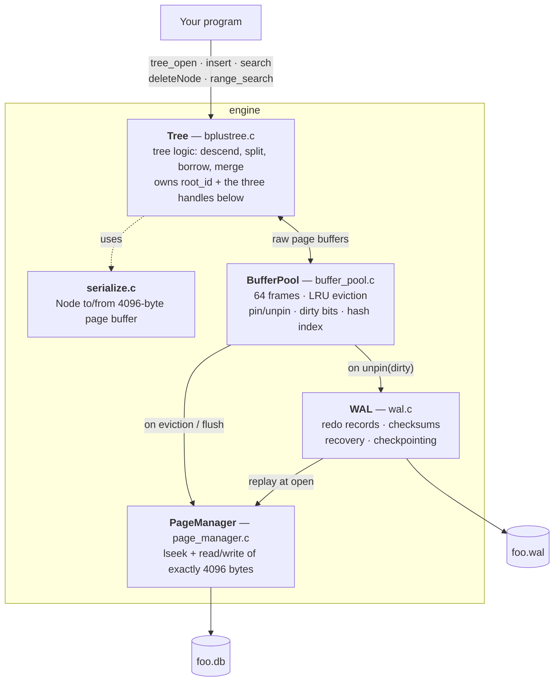
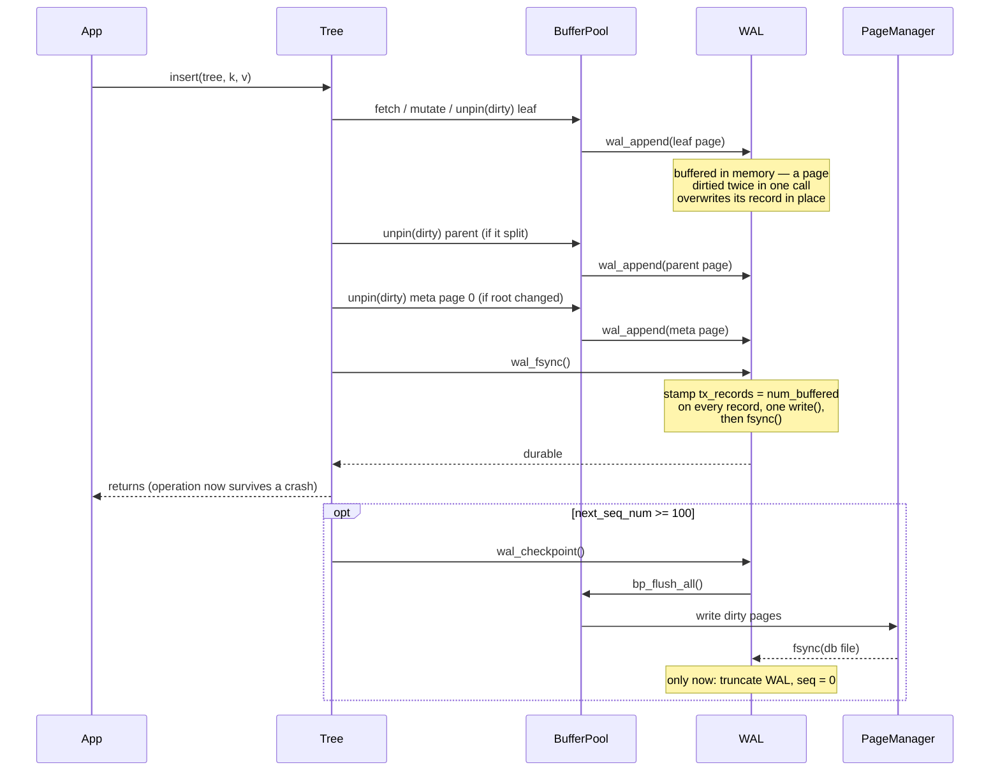
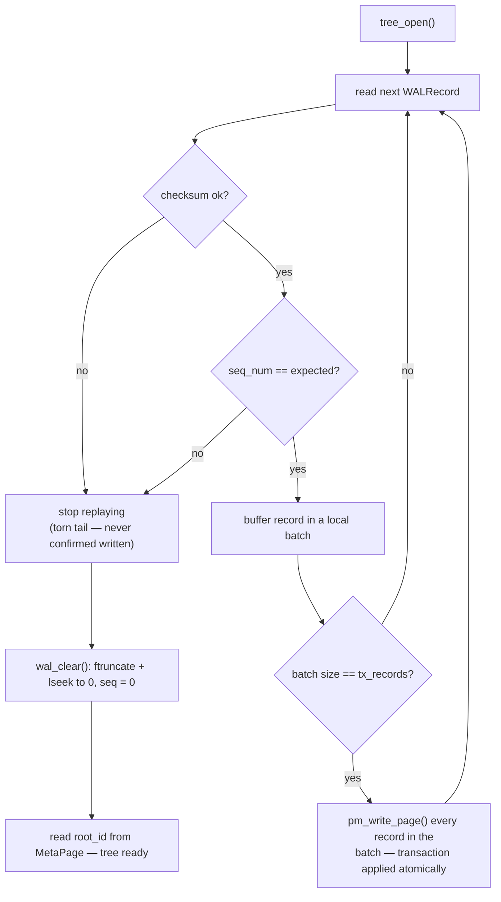

# B+Tree Storage Engine

A persistent, embedded key–value store written from scratch in C: an on-disk
B+Tree over fixed-size pages, fronted by an LRU buffer pool and made durable by
a redo-only, checksummed Write-Ahead Log. No server, no network layer, no
dependencies beyond libc — it is the *storage layer* of a database, in the
spirit of LMDB or SQLite's pager, in miniature.

```
                   insert / search / delete / range_search
                                    |
   +--------------------------------v--------------------------------+
   |  B+Tree          keys are ints, leaves chained for range scans   |
   +-----------------------------------------------------------------+
   |  Buffer pool     64 frames | LRU | pin/unpin | dirty tracking    |
   +------------------------------+----------------------------------+
   |  Page manager                |  WAL                             |
   |  raw 4096-byte page I/O      |  redo log, checksummed, fsync'd   |
   +--------------+---------------+---------------+------------------+
                  v                               v
              foo.db  (pages)                 foo.wal  (records)
```

| | |
|---|---|
| **Language** | C (C99), builds with gcc / mingw-w64 |
| **Dependencies** | libc only (Python 3 for the crash-test harnesses) |
| **Page size** | 4096 bytes |
| **Fan-out** | `MAX_KEYS = 4` (deliberately tiny — see [Tunables](#tunables)) |
| **Durability** | redo-only WAL, `fsync` per operation, checksummed records |
| **Concurrency** | single-threaded, single-writer, single-process (by design) |
| **Platforms** | Linux, macOS, Windows (mingw-w64) |

---

## Table of contents

1. [Quick start](#quick-start)
2. [Architecture](#architecture)
3. [Data model](#data-model)
4. [On-disk format](#on-disk-format)
5. [The buffer pool](#the-buffer-pool)
6. [Durability: WAL, checkpoints, recovery](#durability-wal-checkpoints-recovery)
7. [Tree operations, step by step](#tree-operations-step-by-step)
8. [API reference](#api-reference)
9. [Testing](#testing)
10. [Design limits and known issues](#design-limits-and-known-issues)
11. [Repository layout](#repository-layout)
12. [Deeper documentation](#deeper-documentation)

---

## Quick start

### Build and test

```bash
make                    # build every test binary into tests/bin/
make test               # run the unit/integration suite (golden-file diffed)
make stress-invariants  # 10k random ops, validate_tree() after every one
make chaos              # 50  kill -9 crash/recover cycles
make stress             # 100 kill -9 cycles, larger workload
make crash-cycle        # repeated kill -9 against a DB that is never wiped
make clean
```

Everything compiles with `-Wall -Wextra -g -fsanitize=address,undefined`.
ASan and UBSan are always on; there is no separate release configuration.

### Using the engine

There is no library artifact — link the engine sources directly into your
program:

```bash
gcc -I. -o app app.c src/bplustree.c src/buffer_pool.c \
                     src/page_manager.c src/wal.c src/serialize.c
```

```c
#include "src/bplustree.h"
#include <stdint.h>
#include <stdio.h>

int main(void) {
    /* Opens or creates both files, and replays the WAL if the last
       process died without closing cleanly. */
    Tree *tree = tree_open("app.db", "app.wal");
    if (!tree) return 1;

    for (int i = 0; i < 1000; i++)
        insert(tree, i, (void *)(int64_t)i);   /* durable when insert() returns */

    int64_t v = (int64_t)search(tree, 42);     /* -> 42 */
    printf("key 42 = %lld\n", (long long)v);

    int    keys[64];
    void  *vals[64];
    int    n = 0;
    range_search(tree, 100, 163, keys, vals, &n);   /* [100, 163] inclusive */
    printf("range returned %d keys\n", n);

    deleteNode(tree, 42);

    tree_close(tree);   /* flushes the buffer pool, fsyncs, frees everything */
    return 0;
}
```

Two things to internalise before writing against this API:

* **Values are pointer-sized integers, not buffers.** A value is stored as an
  `int64_t` inside the leaf page. Passing a heap pointer stores the *address*,
  which is meaningless after a restart. Store small integers, or an offset into
  a payload file you manage yourself.
* **Each `insert`/`deleteNode` call is its own transaction** and `fsync`s before
  returning. That is the durability guarantee, and also the throughput ceiling:
  one disk flush per operation.

---

## Architecture

Four layers, each a `src/*.c` / `.h` pair, wired together by `Tree`.



| Layer | File | Responsibility | Knows about |
|---|---|---|---|
| Tree | `src/bplustree.c` | public API, descent, splits, borrows, merges, invariant checking | buffer pool, WAL (for `fsync`/checkpoint) |
| Serialization | `src/serialize.c` | `Node` to/from raw `PAGE_SIZE` bytes | the `Node` layout only |
| Buffer pool | `src/buffer_pool.c` | caching, LRU eviction, pin/unpin, dirty tracking, WAL-append on dirty | page manager, WAL |
| WAL | `src/wal.c` | append records, `fsync`, recover, checkpoint, truncate | page manager (via the pool) |
| Page manager | `src/page_manager.c` | raw page I/O, file growth, page allocation | the file descriptor only |
| Compat shims | `src/compat.h` | `fsync` on mingw, atomic `rename` on Windows | — |

Ownership is strictly top-down: `Tree` owns one `WAL *`, one `BufferPool *` and
one `PageManager *`; the pool holds borrowed pointers to the WAL and the page
manager. The pool is the layer that decides when a write goes to the log (on
`bp_unpin(..., mark_dirty=true)`) versus to the backing file (on eviction or an
explicit flush) — the tree never talks to either file directly.

---

## Data model

Keys are `int`. Values are pointer-sized integers (`int64_t` on disk).
Duplicate keys are ignored: inserting an existing key is a silent no-op, not an
update.

### Shape of the tree

With `MAX_KEYS = 4`, a tree holding keys 1–20 looks roughly like this. Inner
nodes route; only leaves hold values; leaves are chained left-to-right.

```
                            +-----------+
              root (inner)  |  9 | 15   |
                            +--+---+---++
                   +-----------+   |    +------------+
                   v               v                 v
             +-----------+   +-----------+     +-----------+
     inner   | 3 | 6     |   | 11 | 13   |     | 17 | 19   |
             +-+---+---+-+   +-+---+---+-+     +-+---+---+-+
               v   v   v       v   v   v         v   v   v
   leaves:  [1,2][3,4,5][6,7,8] -> [9,10][11,12][13,14] -> [15,16][17,18][19,20]
              +--next_id--+--------+------+--------+-------+------>  INVALID_PAGE_ID
```

Invariants, all checked by `validate_tree()`:

* every leaf sits at the **same depth**;
* keys within a node are **strictly sorted**;
* every non-root node holds between `MAX_KEYS/2` and `MAX_KEYS` keys;
* an inner node with *k* keys has exactly *k+1* children;
* the leaf chain visits every key in ascending order.

### The `Node` struct

One node occupies exactly one page. Leaves and inner nodes share a header and
overlay their payload in a union, tagged by `is_leaf`:

```c
#define MAX_KEYS 4

typedef struct Node {
    page_id_t page_id;        /* this node's own page id           */
    page_id_t parent_id;      /* INVALID_PAGE_ID (-1) for the root */
    int       num_keys;
    bool      is_leaf;
    int       keys[MAX_KEYS];
    union {
        struct {                            /* leaf  */
            int64_t   values[MAX_KEYS];
            page_id_t next_id;              /* right sibling, for range scans */
        } leaf;
        struct {                            /* inner */
            page_id_t children[MAX_KEYS + 1];
        } inner;
    } data;
} Node;
```

`page_id_t` is `int64_t`; `INVALID_PAGE_ID` is `-1`.

### Tunables

| Constant | Value | Where | Effect of changing it |
|---|---|---|---|
| `PAGE_SIZE` | 4096 | `page_manager.h` | file offsets, WAL record size |
| `MAX_KEYS` | 4 | `bplustree.h` | fan-out; **breaks existing DB files and several golden-file tests** |
| `BUFFER_POOL_SIZE` | 64 frames | `buffer_pool.h` | memory footprint (~256 KB of frames), hit rate |
| `HASH_TABLE_SIZE` | 127 | `buffer_pool.h` | page-table collision rate |
| WAL transaction buffer | 64 records | `wal.c` | max pages one operation may dirty |
| Checkpoint threshold | 100 records | `bplustree.c` | how large the WAL grows before a checkpoint |

`MAX_KEYS = 4` is intentionally tiny: it forces splits, borrows and merges to
run constantly even on toy inputs, so the rebalancing paths are exercised by
every test rather than only under load.

---

## On-disk format

A database is **two files**: the page file and its WAL.

```
foo.db  +--------------+--------------+--------------+-----+
        | page 0       | page 1       | page 2       | ... |   each exactly
        | MetaPage     | Node         | Node         |     |   4096 bytes
        +--------------+--------------+--------------+-----+
        offset(page_id) = page_id * 4096

foo.wal +---------------+---------------+-----+
        | WALRecord #0  | WALRecord #1  | ... |   each exactly 4120 bytes
        +---------------+---------------+-----+
```

### Page 0 — the meta page

```c
#define META_MAGIC_NUMBER 0x42504C53   /* "BPLS" */

typedef struct MetaPage {
    uint32_t  magic_number;
    page_id_t root_id;
} MetaPage;
```

Written once, when `tree_open()` finds an empty file. `update_root()` rewrites
`root_id` whenever a split or a collapse changes which page is the root —
through the buffer pool and the WAL, exactly like any other page, so the root
pointer is as crash-safe as the data. (The magic number is written but, today,
never verified on open — see [known issues](#design-limits-and-known-issues).)

### Pages 1..N — node pages

Serialization is a straight struct copy:

```c
bool serialize_node(const Node *node, void *buffer) {
    memset(buffer, 0, PAGE_SIZE);
    memcpy(buffer, node, sizeof(Node));
    return true;
}
```

So a node page is a raw memory image of the struct, padded with zeros. On the
reference build (x86-64, gcc, default packing) the bytes land like this:

```
byte  0 +----------------------------+
        | page_id        int64   8 B |
      8 +----------------------------+
        | parent_id      int64   8 B |
     16 +----------------------------+
        | num_keys       int     4 B |
     20 +----------------------------+
        | is_leaf        bool    1 B | + 3 B padding
     24 +----------------------------+
        | keys[4]        int    16 B |
     40 +----------------------------+
        | union data            40 B |  leaf:  values[4] 32 B + next_id 8 B
        |                            |  inner: children[5] 40 B
     80 +----------------------------+
        | zero padding        4016 B |  <- ~98% of the page
   4096 +----------------------------+
```

Two consequences worth stating plainly rather than discovering later:

* **Space.** `sizeof(Node)` is 80 bytes, so a node page is ~98% padding. That is
  the price of page-per-node addressing (`page_id * PAGE_SIZE` *is* the offset),
  not a bug.
* **Portability.** Struct padding, `int` width and endianness leak straight into
  the file, and there is no format version field. A `.db` file is only
  guaranteed readable by a byte-identical build. Do not copy database files
  between architectures or compilers.

### File growth

`pm_allocate_page()` appends one zeroed page and returns its id — the normal
path. `pm_write_page()` additionally **grows the file on demand** if handed a
`page_id >= num_pages`: it seeks to the last byte of the target page, writes one
byte, and bumps `num_pages`. This is load-bearing, not sloppy: WAL recovery
replays pages that were allocated by a *previous, crashed* process and so were
never allocated in this one.

---

## The buffer pool

64 frames of 4096 bytes sit between the tree and the disk, indexed by a chained
hash table so `page_id -> frame` is O(1).

```
            hash_lookup(page_id)                 Frame
         +----------------------+      +---------------------------+
 page_id | page_table[127]      | ---> | page_id                   |
   --->  |  chained HashNodes   |      | data        -> 4096 B     |
         +----------------------+      | is_dirty    bool          |
                                       | pin_count   int           |
                                       | last_time_used  int (LRU) |
                                       +---------------------------+
                                          x BUFFER_POOL_SIZE (64)
```

### The pin/unpin contract

The pool deals in **raw bytes only** — it never serializes anything itself. Every
function that touches a page follows the same four steps:

```c
void *raw  = bp_fetch_page(bp, page_id);   /* 1. pin + get the frame buffer   */
Node *node = deserialize_node(raw);        /* 2. decode (caller must free())  */

node->keys[0] = 7;                         /* 3. mutate the decoded copy      */

serialize_node(node, raw);                 /* 4. encode back into the frame   */
bp_unpin(bp, page_id, /*mark_dirty=*/true);/*    unpin — this also WAL-logs   */
free(node);
```

Rules that are easy to violate and expensive to debug:

* The pointer from `bp_fetch_page` is valid **only while pinned**. After
  unpinning, the frame may be recycled for another page; never cache it across
  an unpin.
* `deserialize_node` returns heap memory the pool does not track. The caller
  frees it.
* `bp_unpin(..., true)` *is* the logging call — marking a page dirty appends it
  to the WAL. There is no separate "log this write" call.
* If you skip step 4's `serialize_node`, the mutation is silently lost even
  though the frame is marked dirty.

### Eviction

On a miss with no free frame, the pool picks the victim with the smallest
`last_time_used`, **skipping**:

* frames with `pin_count > 0` — in active use;
* frames whose page still sits in the WAL's unflushed in-memory buffer
  (`wal_contains_page`) — the log is the only durable record of that change, so
  evicting it is not allowed to happen before the log is on disk.

A dirty victim is written to the page file before its frame is reused. Clean
frames are dropped for free.

---

## Durability: WAL, checkpoints, recovery

The model is **redo-only, whole-page, checksummed**. There is no undo log: every
record is a full post-modification snapshot of one page, so replay is idempotent
and ordering within a transaction does not matter.

### Record layout

```c
typedef struct {
    page_id_t page_id;
    int       seq_num;             /* strictly increasing, from 0            */
    uint32_t  checksum;            /* djb2-like, over page_data             */
    int       tx_records;          /* how many records form this transaction */
    char      page_data[PAGE_SIZE];
} WALRecord;                       /* 4120 bytes on the reference build      */
```

```
 0        8       12      16      24                                    4120
 +--------+-------+-------+-------+---------------------------------------+
 |page_id |seq_num|cksum  |tx_recs| page_data[4096]                       |
 +--------+-------+-------+-------+---------------------------------------+
```

The checksum detects a torn or partial write from a crash mid-`write()`. It is a
cheap rolling hash, not a cryptographic digest — it is not meant to catch
deliberate tampering or long-term bit rot.

### What a transaction is

A transaction is implicit: **every page dirtied during one `insert()` or
`deleteNode()` call**, which can be several pages when a split or a cascading
merge propagates. The grouping works like this:



Before `wal_fsync()` returns, a crash loses the whole in-flight operation — which
is correct: the main database file was never touched either, so the tree is
simply as it was before the call.

### Recovery

`wal_recover()` runs on **every** `tree_open()`, scanning the log from byte 0 and
applying complete transactions directly to the page file, bypassing the buffer
pool:



The two "stop" edges are the whole safety argument: a bad checksum or a gap in
sequence numbers means the tail of the log was never fully written, so nothing
after that point may be trusted — and a transaction whose records are only
partly present is never applied at all.

### Checkpointing vs. clearing

Both end with an empty WAL, and confusing them is how durability bugs get
written.

| | `wal_checkpoint(bp)` | `wal_clear(wal)` |
|---|---|---|
| Called from | `insert`/`deleteNode`, once `next_seq_num >= 100` | right after `wal_recover()`, every `tree_open()` |
| Precondition | dirty pages still live only in the pool + log | recovery already wrote every page via `pm_write_page` |
| Steps | `wal_fsync` -> `bp_flush_all` -> `fsync(db)` -> truncate + rewind | truncate + rewind |
| On flush failure | **aborts, leaves the WAL intact** | n/a |

Two hard-won rules live in that table:

* **Never truncate the log before the pages are durable in the page file.** If
  `bp_flush_all()` fails, the WAL is still the only copy, so the checkpoint
  aborts and returns `false` rather than truncating.
* **`ftruncate` alone is not enough — reset the file offset too.** Truncating
  without `lseek(fd, 0, SEEK_SET)` leaves the descriptor's write offset where
  the recovery scan stopped, so the next flush writes past a zero-byte hole. A
  zeroed record checksums to 0 and parses as `seq_num == 0`, so the *following*
  recovery mistakes the hole for a valid transaction and then rejects the real
  records after it — silent data loss, visible only from the second
  crash/recover cycle onward. This was a real bug (fixed in `36c70de`), and it
  took `make crash-cycle` to find it.

---

## Tree operations, step by step

### Search — `search(tree, key)`

Descend from the root: in an inner node, advance while `key >= keys[i]`, then
follow `children[i]`; at the leaf, scan for an exact match. Returns the value,
or `NULL` if absent. Read-only: never touches the WAL.

### Range scan — `range_search(tree, start, end, keys, vals, &n)`

Descend to the leaf containing `start`, then ride `leaf.next_id` rightward
collecting pairs until a key exceeds `end`. Bounds are inclusive; the caller
supplies both output arrays and is responsible for their capacity.

### Insert — bottom-up split

Descend to the target leaf. If it has room, insert in sorted position and you
are done (duplicates are ignored). If it is already at `MAX_KEYS`, split it,
then push the separator upward — which may cascade and, at the root, grow the
tree by one level.

```
leaf is full, insert 7:

   before          [2, 4, 6, 8]                 <- num_keys == MAX_KEYS
                        |  split at num_keys/2
                        v
   after      [2, 4] --next--> [6, 7, 8]
                   ^               ^
                   +-- parent gains separator 6 --+

   parent full too? split_inner_node pushes its middle key up as well,
   recursing toward the root; a split at the root creates a new root and
   update_root() rewrites page 0.
```

Leaf splits **copy** the separator up (the key stays in the right leaf, since
leaves must hold every key); inner splits **move** their middle key up.

### Delete — borrow before merge

Remove the key from its leaf. If the node still has at least `MAX_KEYS/2` keys,
stop. Otherwise rebalance, cheapest option first:

```
1. borrow from the left sibling   (if it has a key to spare)

       parent:    [ 20 ]                        parent:    [ 17 ]
   left [10,14,17]   right [22]     ---->   left [10,14]   right [20,22]

   the separator rotates down into the underfull node, and the sibling's
   outermost key rotates up into the parent

2. borrow from the right sibling  (mirror image of the above)

3. merge                          (neither sibling can spare a key)

       parent:    [ 20 ]                        parent:    [ ]
   left [10]         right [22]     ---->   left [10, 20, 22]

   the separator is pulled down and removed from the parent, which may now
   be underfull itself — recurse upward. A root left with 0 keys collapses
   into its only child, and the tree loses a level.
```

`merge_with_sibling()` refuses a merge whose combined key count would exceed
`MAX_KEYS` (covered by `tests/test_merge_guard.c`).

### Validation — `validate_tree(tree)`

The ground truth for correctness: walks the whole tree, checking equal leaf
depth, key bounds, strict ordering and child counts. The fuzz and stress tests
call it after *every single operation*; a failure is a real bug, never flaky
test infrastructure.

---

## API reference

### Lifecycle

| Function | Description |
|---|---|
| `Tree *tree_open(const char *db, const char *wal)` | Opens or creates both files, runs WAL recovery, loads `root_id` from the meta page. Returns `NULL` on failure — including a WAL that cannot be opened, which is deliberately fatal rather than silently non-durable. |
| `void tree_close(Tree *tree)` | Flushes dirty frames, `fsync`s, closes both files, frees everything. |

### Data operations

| Function | Returns | Notes |
|---|---|---|
| `page_id_t insert(Tree *, int key, void *value)` | current root page id | Durable on return. Existing key -> no-op. |
| `void *search(Tree *, int key)` | value, or `NULL` | Read-only, no log traffic. |
| `page_id_t deleteNode(Tree *, int key)` | current root page id | Durable on return; rebalances as needed. |
| `bool range_search(Tree *, int start, int end, int keys[], void *vals[], int *n)` | `true` on success | Inclusive bounds; caller-provided arrays. |
| `bool validate_tree(Tree *)` | `true` if every invariant holds | Debug/test tool; walks the whole tree. |

### Lower layers

Useful when reading the code or writing tests directly against one layer.

| Layer | Functions |
|---|---|
| Page manager | `pm_open`, `pm_close`, `pm_allocate_page`, `pm_read_page`, `pm_write_page` |
| Buffer pool | `bp_create`, `bp_destroy`, `bp_fetch_page`, `bp_pin`, `bp_unpin`, `bp_flush_page`, `bp_flush_all`, `hash_insert`, `hash_lookup`, `hash_remove` |
| WAL | `wal_open`, `wal_append`, `wal_fsync`, `wal_close`, `wal_recover`, `wal_clear`, `wal_checkpoint`, `wal_contains_page` |
| Serialization | `serialize_node`, `deserialize_node` |
| Tree internals | `create_leaf_node`, `create_inner_node`, `split_leaf`, `split_inner_node`, `insert_into_parent`, `insert_into_leaf_sorted`, `find_key_in_node`, `try_borrow_from_left_sibling`, `try_borrow_from_right_sibling`, `merge_with_sibling`, `remove_from_parent` |

---

## Testing

There is no spec beyond `validate_tree()`, so the test suite *is* the definition
of correct. It comes in four layers, each catching a class the others cannot.

| Layer | Command | What it does | Catches |
|---|---|---|---|
| 1 — unit / integration | `make test` | 19 binaries, stdout diffed against `tests/expected/*.expected`, under ASan+UBSan | logic errors, memory bugs, exact tree shapes |
| 2 — in-process fuzz | `make stress-invariants` | 10k random ops, `validate_tree()` after each | split/borrow/merge invariant violations |
| 3 — kill -9 chaos | `make chaos` / `make stress` | 50 / 100 cycles: run a workload 10–200 ms, `SIGKILL` it, reopen, verify every acknowledged key | torn writes, lost transactions |
| 4 — persistent crash cycle | `make crash-cycle` | repeated `SIGKILL` against a DB **never wiped** between cycles | recovery-of-a-recovery bugs |

Layer 4 exists because layers 1–3 all start from a clean file, and the worst bug
this project has had only appeared from the *second* recovery against the same
file onward. If you touch `wal.c`, `wal_recover`, `wal_clear`, `wal_checkpoint`
or the dirty/flush paths in `buffer_pool.c`, run it:

```bash
python3 tests/crash_cycle_test.py [iterations] [seed]   # default: 20, fixed seed
```

Tests worth knowing by name:

* **`test_validate`** — randomized insert/delete fuzzing, up to 1,000,000 ops,
  validating after every one. The main defense against subtle rebalancing bugs.
* **`test_recovery`** — data written before a simulated crash survives a reopen.
* **`test_checkpoint`** — data survives a crash *immediately after* a checkpoint,
  i.e. when the WAL is already empty and the page file must stand on its own.
* **`test_reopen`** — `root_id` survives a clean close/reopen via the meta page.
* **`test_merge_guard`** — merges that would exceed `MAX_KEYS` are refused, valid
  merges still succeed.
* **`test_buffer_pool`** — LRU order, pin protection, dirty-bit behaviour,
  hash-table collisions.
* **`test_serialize`** — `Node` round-trips through the page buffer unchanged.

Adding a test: write `tests/test_x.c`, add `test_x` to `TESTS` in the `Makefile`,
run it once, and save the output as `tests/expected/test_x.expected` — but only
after reading it and confirming it is actually correct, not merely what the code
happened to print.

Result to date: **100 random crash-recovery cycles with zero data loss or
corruption.**

### Requirements

`gcc` (mingw-w64 on Windows — MSVC will not build this; see
[platform-portability.md](docs/handoff/platform-portability.md)) and Python 3,
stdlib only, for the layer 3–4 harnesses.

---

## Design limits and known issues

Stated up front, because every one of these is either a deliberate scope
boundary or a known sharp edge — not an oversight waiting to be "fixed"
opportunistically.

**By design**

* **Single-threaded, single-process.** No locking anywhere. `Tree`, `BufferPool`
  and `WAL` must not be shared across threads, and two processes must not open
  the same database.
* **One `fsync` per operation.** No group commit, and no explicit transaction
  API — you cannot make several inserts atomic together.
* **`int` keys, pointer-sized integer values.** No variable-length keys, no
  blobs, no overflow pages.
* **Page-per-node with `MAX_KEYS = 4`** — ~98% of each page is padding. The payoff
  is a trivially simple address mapping and constant exercise of the rebalancing
  paths.

**Sharp edges**

* **`wal_append`'s return value is ignored in `bp_unpin`.** If an append fails,
  the page is still marked dirty and the caller proceeds as if it were logged.
* **The WAL transaction buffer caps at 64 records.** One operation that dirties
  more than 64 pages would fail to log the 65th onward — unlikely at
  `MAX_KEYS = 4`, not impossible, and nothing currently checks for it.
* **`META_MAGIC_NUMBER` is written but never verified**, and node pages carry no
  version field. Pointing `tree_open()` at a foreign file, or at one written by
  a build with a different `Node` layout, is misread as garbage rather than
  rejected.
* **Checksums are non-cryptographic** — sized to catch torn writes, not tampering.
* **The on-disk format is not portable** across compilers, architectures or ABIs.

Full history, including the five bugs fixed in `36c70de`, is in
[known-issues.md](docs/handoff/known-issues.md).

---

## Repository layout

```
src/
  bplustree.c/.h     tree logic + public API + Tree/Node/MetaPage types
  buffer_pool.c/.h   LRU pool, frames, pin/unpin, page table
  page_manager.c/.h  raw 4096-byte page I/O, allocation, file growth
  wal.c/.h           records, append, fsync, recover, checkpoint
  serialize.c/.h     Node to/from page buffer
  compat.h           mingw fsync(), Windows atomic_replace()
tests/
  test_*.c           unit/integration suites (one binary each)
  expected/          golden stdout files the suite diffs against
  *_workload.c       long-running workloads for the kill -9 harnesses
  verify_*.c         post-crash verifiers
  crash_cycle.c      persistent-DB crash target
  *.py               chaos / stress / crash-cycle harnesses (Python 3)
  bin/  results/     build + run output (gitignored)
docs/handoff/        deep-dive documentation (see below)
Makefile             build, test, chaos, stress, crash-cycle, clean
```

Build output and stray `*.db` / `*.wal` / `*.log` artifacts are gitignored. If
one shows up in `git status`, check what is in it before adding it.

---

## Deeper documentation

This README is the overview; `docs/handoff/` is the reference, and
[HANDOFF.md](HANDOFF.md) is the orientation for someone taking the project over.

| Topic | File |
|---|---|
| Layers, data flow, pin/unpin contract, invariants | [architecture.md](docs/handoff/architecture.md) |
| Page layout, `Node`/`MetaPage` format, portability | [on-disk-format.md](docs/handoff/on-disk-format.md) |
| WAL records, transactions, checkpointing, recovery | [wal-recovery.md](docs/handoff/wal-recovery.md) |
| Toolchain, Makefile targets, build flags | [build-environment.md](docs/handoff/build-environment.md) |
| Windows/mingw shims, `O_BINARY`, why they exist | [platform-portability.md](docs/handoff/platform-portability.md) |
| Test suite structure, harnesses, adding a test | [testing.md](docs/handoff/testing.md) |
| Naming, error handling, code layout conventions | [conventions.md](docs/handoff/conventions.md) |
| Fixed bugs and what to still watch out for | [known-issues.md](docs/handoff/known-issues.md) |

## Status

Core B+Tree, page manager, buffer pool and WAL are complete and covered by the
four test layers above. The engine is feature-complete for its scope: a durable,
crash-safe, single-writer embedded key–value store.
